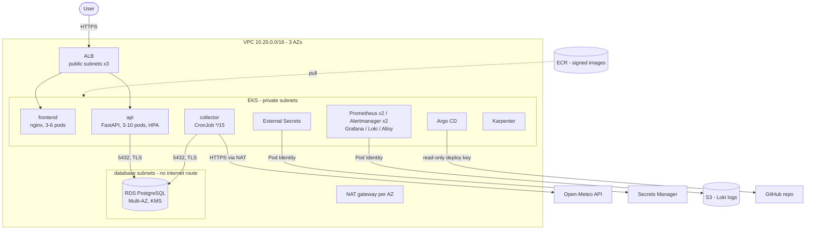
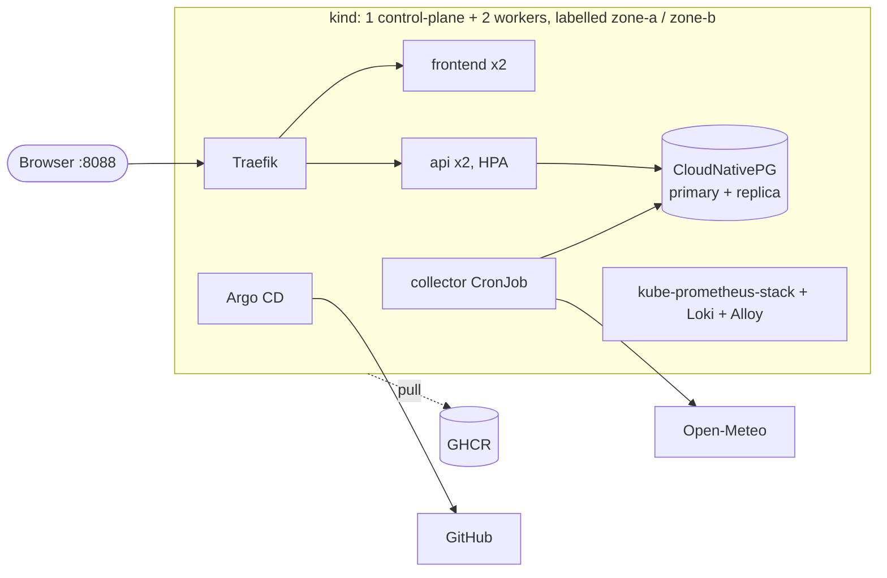

# Architecture

## 1. AWS (prod)

**Network layers.** Public subnets hold only the ALB and NAT gateways. Workloads run in
private /20 subnets, sized for VPC CNI pod IPs. The database sits in isolated subnets with
no route to the internet, and its security group only accepts the EKS node SG on 5432.
Inside the cluster, NetworkPolicies are **default-deny**. Each allowed path is listed
explicitly: ingress -> frontend/api, api/collector -> DB CIDRs on 5432, collector ->
internet on 443, monitoring -> api metrics port. The VPC CNI's `enableNetworkPolicy` is
switched on, because without it EKS accepts NetworkPolicies but doesn't enforce them.

## 2. Local (kind)

The local environment is built by Terraform (`infra/environments/local`). It is a real
Kubernetes cluster with real failover, NetworkPolicy enforcement and GitOps, rather than
emulated AWS APIs ([ADR-0010](adr/0010-local-environment.md)).

## 3. Components

| Component | What it does | Why it is separate |
|---|---|---|
| **frontend** | React SPA served by unprivileged nginx. Calls `/api/*` on the same host (no CORS). | Static assets scale differently and need no DB access |
| **api** | `GET /api/locations`, `/api/weather/current`, `/api/weather/{id}/history?hours=`. Read-only. `/healthz` liveness (no DB), `/readyz` readiness (DB), `/metrics`. | Stateless; scales on CPU with HPA |
| **collector** | Every 15 min: one batched Open-Meteo call for all cities, retry with backoff, idempotent upsert. | An external dependency's outage can't affect serving traffic; it runs exactly once per schedule, whatever the API replica count ([ADR-0004](adr/0004-collector-as-cronjob.md)) |
| **migrations** | SQL migrations under a Postgres advisory lock, run as a Helm hook (Argo CD PreSync) before new pods start. | The schema is updated before code that needs it, and never by N replicas racing |
| **PostgreSQL** | `locations`, `weather_observations` with `UNIQUE(location_id, observed_at)`. | Relational, small, history queries by time range: Postgres fits |

### Data flow
1. The collector fetches the current conditions for all 8 cities in one request.
2. It upserts them: `ON CONFLICT (location_id, observed_at) DO NOTHING`, so retries and
   overlapping runs never create duplicates.
3. `/api/weather/current` uses `DISTINCT ON (location_id) ... ORDER BY observed_at DESC`,
   which hits the `(location_id, observed_at DESC)` index.
4. History is capped (`MAX_HISTORY_HOURS`), so one request can't scan the whole table.

## 4. High availability and failure modes

| Failure | What happens | Measured / designed |
|---|---|---|
| Pod crash | Liveness restarts it; readiness takes it out of the Service first | - |
| Node loss | Replicas are spread across nodes and zones (topology spread), PDB keeps ≥1 up during drains | prod: `DoNotSchedule` on zones |
| AZ loss (AWS) | Pods in 3 AZs, NAT per AZ, RDS Multi-AZ standby | RDS failover ~60-120s (AWS) |
| DB primary loss | CNPG/RDS promotes the standby; the API pool validates connections (`check_connection`) and recycles them (`max_lifetime`), so dead sockets don't produce 500s | local: ~31s, 0 HTTP 500s |
| Rolling deploy | `maxUnavailable: 0`, readiness gates, `preStop` sleep so the load balancer drains before shutdown | 1,174 requests, 0 failures |
| Open-Meteo down | Collector retries, then fails the Job. The API keeps serving the last data. Alerts: `WeatherCollectorFailing`, then `WeatherDataStale` | - |
| Someone edits the cluster by hand | Argo CD self-heal reverts it to Git | ~2s |
| Argo CD down | Running apps are unaffected; only new deploys wait | HA Argo CD on AWS |

## 5. Scaling

- **Pods:** the HPA on CPU (70% of request) adds API/frontend replicas, and Karpenter adds
  nodes within seconds of pods going Pending. It picks spot or on-demand instances and
  consolidates nodes when they're under-used.
- **Database:** the API is read-heavy, so the next steps are read replicas, and RDS Proxy
  once `replicas x pool size` gets near `max_connections`. History could be partitioned by
  month if the table grows large. At 8 cities x 96 readings a day it grows ~280k rows a year,
  so this is far off.
- **Edge:** at real scale, put CloudFront in front of the frontend and cache
  `/api/weather/current` for 60s. The data only changes every 15 minutes.

## 6. Security, in layers

| Layer | Control |
|---|---|
| Identity | No static AWS keys anywhere. GitHub Actions -> AWS via OIDC with per-job roles (build / plan / apply). Pods -> AWS via EKS Pod Identity, scoped to specific resources. |
| Secrets | RDS generates and rotates its own master password (Secrets Manager + KMS). External Secrets syncs it into the cluster. Nothing secret is in Git or Terraform variables files. |
| Network | Private subnets, isolated DB subnets, security groups, default-deny NetworkPolicies (enforced, and tested). EKS API endpoint restricted to allowed CIDRs. IMDS hop limit 1 (pods can't steal node credentials). |
| Workloads | Pod Security Standard `restricted` enforced on the namespace: non-root, read-only root filesystem, no privilege escalation, all capabilities dropped, seccomp `RuntimeDefault`. Bottlerocket nodes. |
| Supply chain | Every GitHub Action pinned to a commit SHA. Python dependencies hash-locked (`--require-hashes`). Trivy blocks fixable HIGH/CRITICAL CVEs. Images have SBOM + provenance, are cosign-signed, and tagged with immutable git SHAs. Prod promotion verifies the signatures. Renovate keeps pins fresh. |
| Data | RDS encrypted with a customer-managed KMS key, TLS required, deletion protection plus 14-day PITR in prod. |
| Audit | EKS control-plane audit logs -> CloudWatch. Every change is a Git commit (infra and deploys). |

## 7. Observability

Metrics (Prometheus), alerts (Alertmanager), dashboards (Grafana), logs (Loki via Alloy).
The platform team owns the stack; the app chart ships its own ServiceMonitor, alert
rules and dashboard, so they're versioned with the code they watch.

- **SLO:** 99.5% of `/api/*` requests succeed over 30 days. Alerts use multi-window
  burn rates (14.4x over 1h -> page; 6x over 6h -> ticket), not raw error thresholds.
- **Silent failure covered:** the API exports the age of the newest reading per city, so
  "everything returns 200 but the data is 3 hours old" raises an alert.
- **Every alert** has a severity, a runbook, and a promtool unit test in CI.
  CI also fails if an alert's runbook link is missing or broken.
- **Routing:** critical -> pager channel, warning -> chat. A critical alert suppresses its
  own warning-level twin.

## 8. Cost (rough monthly estimate, us-east-1 list prices, before data transfer)

| Item | dev | prod |
|---|---|---|
| EKS control plane | ~$73 | ~$73 |
| System nodes (2x t3.large / 2x m7i.large) | ~$120 | ~$150 |
| Karpenter workload nodes (spot-first) | ~$30-60 | ~$100-200 |
| NAT gateways (1 / 3) | ~$33 | ~$100 |
| RDS (t4g.micro single-AZ / m7g.large Multi-AZ) | ~$15 | ~$250 |
| ALB, EBS, S3, CloudWatch, Secrets Manager | ~$40 | ~$80 |
| **Total** | **~$300-350** | **~$750-850** |

These are estimates to compare options, not quotes; check them in the AWS Pricing
Calculator. Biggest levers: spot for stateless pods (already on), one NAT in dev (already
on), VPC endpoints for ECR/S3 to cut NAT traffic, Savings Plans once usage is steady,
and turning dev off at night. For an app this size, EKS is a platform investment. See
[ADR-0001](adr/0001-eks-as-the-platform.md) for when that pays off.
